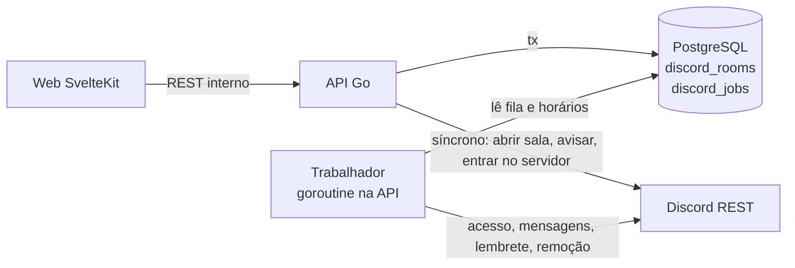
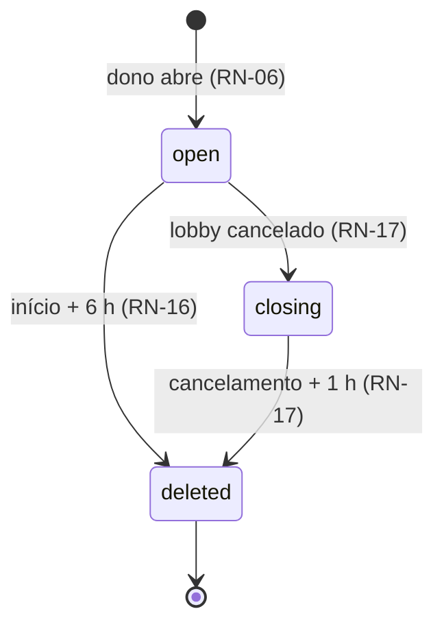

# Design — Sala do grupo no Discord

- Spec: `./spec.md` (revisão de 2026-10-14) · Status: Rascunho
- ADR do projeto: `docs/adr/0009-bot-discord-rest-outbox.md` (resume D-01 a D-03)

## 1. Visão geral
A API ganha um cliente de bot do Discord (REST, `net/http`) e um trabalhador em segundo
plano no mesmo processo. Há dois tipos de efeito no Discord:

- **Síncronos**, em que o dono precisa da resposta na hora: abrir a sala, avisar o grupo e
  incluir o jogador no servidor na conexão.
- **Assíncronos**, que nunca travam o domínio (RN-21): acesso aos canais, mensagens de
  entrada, saída, cancelamento e horário, lembrete e remoção.

Os assíncronos nascem na mesma transação da ação do domínio, numa fila no banco (*outbox*).
Os de horário (lembrete e remoção) não ficam na fila: o trabalhador os deduz do estado da
sala e do lobby, como o projeto já faz com o estado do lobby.





## 2. Análise de reuso
| Existente | Onde | Uso nesta feature |
|---|---|---|
| Cliente OAuth (`exchange`, `me`) | `internal/discord/client.go` | Ganha `JoinGuildFromCode`, que reaproveita a troca do código; o token continua sem sair do pacote (RN-02) |
| Fluxo OAuth com `state` em cookie | `web/src/routes/auth/discord/*`, `lib/auth/oauth.ts` | Mesmo padrão para `/perfil/discord`, com `scope=identify guilds.join` (RN-01) |
| Discord falso | `internal/discordfake`, `cmd/fakediscord` | Ganha as rotas do bot e um registro do que o bot fez, para os testes conferirem (RNF-03) |
| `inTx`, `LockUser`, transições das candidaturas | `internal/applications`, `internal/lobbies` | Os pontos onde a fila recebe os efeitos (aceitar, sair, remover, editar, cancelar) |
| `Detail(viewerID)` e visibilidade por quem olha | `internal/lobbies/detail.go` | Ganha o bloco `discord`, só para membros (RN-18, RN-19) |
| Formatação de horário de Brasília | `lobbies.mustLoad`, `compartilhar-lobby` | Texto das mensagens do bot (RN-08, RN-15) |
| Validação por campo (`ValidationError`) | `internal/lobbies` | Link do Discord do dono (RN-23) |

Não reusado: uma lib de bot (`discordgo`). O projeto já fala com o Discord em `net/http`
(ADR-02), e o bot usa poucas rotas REST e nenhum gateway (ver D-01).

## 3. Componentes e interfaces

### Backend
- **`internal/discord`** (estende o cliente atual)
  - `JoinGuildFromCode(ctx, code, redirectURI, expectedDiscordID, guildID) (Profile, error)`:
    troca o código, lê `/users/@me`, recusa com `ErrWrongAccount` se o ID não bate e
    chama `PUT /guilds/{guild}/members/{user}` com o token do bot e o `access_token`
    (201 ou 204 são sucesso, RN-04). O token é descartado. [RN-01 a RN-04]
- **`internal/discordbot`** (novo): cliente do bot, com `Authorization: Bot <token>`.
  - `CreateRoom(ctx, name, allowIDs) (Room{CategoryID, TextID, VoiceID}, error)`: cria
    a categoria, o canal de texto e o de voz (D-04). Se uma das criações falha, apaga o
    que criou antes de devolver o erro. [RN-05, RN-07, CA-02.7]
  - `Allow(ctx, channelID, userID)`, `Revoke(ctx, channelID, userID)`,
    `Post(ctx, channelID, Message)`, `DeleteChannel(ctx, channelID)`: aqui, 404 conta como
    sucesso (CA-05.5).
  - Toda mensagem vai com `allowed_mentions: {parse: [], users: [ids]}` (D-06).
  - Rate limit: no `429`, espera `retry_after` uma vez se couber no prazo; senão devolve
    `ErrUnavailable`. Erro `30013` (limite de canais) vira `ErrGuildFull`. [RNF-02, RN-20]
- **`internal/discordroom`** (novo): regras da sala.
  - `Open(ctx, ownerID, lobbyID)`: trava o lobby (`FOR UPDATE`), confere dono, lobby
    aberto e sem sala, chama `CreateRoom`, grava a sala e enfileira a mensagem de
    abertura. [RN-05 a RN-09, RN-20]
  - `Alert(ctx, ownerID, lobbyID)`: trava a sala, confere dono, sala aberta e intervalo,
    posta e só então grava `last_alert_at`. [RN-26 a RN-28]
  - `Connect(ctx, userID, code, redirectURI)`: chama `JoinGuildFromCode`, grava
    `discord_connected_at` e enfileira acesso e menção nas salas abertas dos lobbies em
    que o Usuário é membro. [RN-01 a RN-04, RN-13]
  - Funções de fila chamadas dentro das transações existentes, que não fazem nada se o
    lobby não tem sala aberta:
    - `OnMemberJoined(q, lobbyID, userID)` [RN-10];
    - `OnMemberLeft(q, lobbyID, userID)` [RN-11];
    - `OnStartChanged(q, lobbyID)` [RN-15];
    - `OnCancelled(q, lobbyID, reason)` [RN-17].
  - `View(ctx, lobbyID, viewer)`: monta o bloco `discord` do detalhe. [RN-18, RN-19,
    RN-24, RN-27]
- **`internal/discordroom/worker.go`**: `Run(ctx)` a cada 5 segundos.
  1. Pega jobs vencidos com `FOR UPDATE SKIP LOCKED` e os executa. Uma falha agenda nova
     tentativa com espera crescente (2ⁿ s, no máximo 5 min). Um job de sala apagada é
     descartado. [RN-21, RNF-04]
  2. Posta o lembrete das salas que estão na janela da RN-14 e grava `reminder_sent_at`.
  3. Apaga as salas vencidas (RN-16, RN-17): apaga voz, texto e categoria e grava
     `deleted_at`.
- **Ganchos nos serviços existentes**:
  - `applications`: `Accept` chama `OnMemberJoined`; `Leave` e `Remove` chamam
    `OnMemberLeft`. As trocas de personagem não chamam nada (RN-12).
  - `lobbies`: `Update` chama `OnStartChanged` quando o início muda, `Cancel` chama
    `OnCancelled`, e `Create` e `Update` validam e gravam `discord_link` (RN-23).
- **Config**: `DISCORD_BOT_TOKEN` e `DISCORD_GUILD_ID`. As duas juntas ligam a feature, e
  nenhuma das duas a desliga. Só uma delas é erro de configuração na subida. [RN-22]
- **`cmd/api/main.go`**: com a feature ligada, cria o cliente do bot e sobe o
  trabalhador com o `ctx` do processo (para no `SIGTERM`).

### Endpoints
| Método | Rota | Quem | Entrada | Saída | Erros | IDs |
|---|---|---|---|---|---|---|
| POST | `/me/discord-connection` | sessão | `{code, redirectUri}` | 200 `{connectedAt}` | 401; 404 `discord_disabled`; 409 `wrong_account`; 422 `invalid_code`; 503 `discord_unavailable` | US-01 |
| GET | `/me` | sessão | — | `User` + `discordConnectedAt?` e `discordEnabled` | 401 | RN-18, RN-22 |
| GET | `/lobbies/{id}` | todos | — | `LobbyDetail` + `discord?` (só membros, D-05) | 404 | US-03, US-07 |
| POST | `/lobbies` e PUT `/lobbies/{id}` | dono | + `discordLink?` | `Lobby` | 422 `discordLink: invalid` | RN-23 |
| POST | `/lobbies/{id}/discord-room` | dono | — | 201 `DiscordRoom` | 401; 404; 409 `not_owner`, `not_open`, `room_exists`; 503 `discord_unavailable`, `guild_full` | US-02 |
| POST | `/lobbies/{id}/discord-alert` | dono | — | 204 | 401; 404; 409 `not_owner`, `no_room`; 429 `{retryAfterSeconds}`; 503 `discord_unavailable` | US-08 |

Bloco `discord` do detalhe, presente só quando quem olha é membro:
```yaml
discord:
  enabled: boolean            # bot configurado (RN-22)
  ownerLink: string | null    # RN-23, existe mesmo com enabled=false (RN-24)
  room:                       # null sem sala ou com a feature desligada
    status: open | closing | deleted
    url: string | null        # só com status=open: https://discord.com/channels/{guild}/{text}
    alertAvailableAt: date-time | null   # só para o dono (RN-27)
  members: [{ userId, nick, connected: boolean }]  # RN-18
  viewerConnected: boolean
```

### Web
- **Perfil**: seção "Discord" com "Entrar no servidor do RO Lobby" ou "Conectado em
  <data>" com "Reconectar". Rotas `perfil/discord` (gera o `state` e redireciona) e
  `perfil/discord/retorno` (confere o `state`, chama a API e volta ao perfil com a
  mensagem). Só aparece com `discordEnabled`. [US-01]
- **Detalhe do lobby**: componente `DiscordSection` com os estados da RN-18, o botão
  "Abrir sala no Discord", o botão "Avisar no Discord" com a contagem regressiva do
  intervalo e o link do anfitrião. Actions `openRoom` e `alert`. [US-02, US-03, US-07,
  US-08]
- **Criar e editar lobby**: campo opcional "Link do seu Discord", com a ajuda "Só os
  membros aceitos veem". [US-07]
- Home, convite, Open Graph e talentos não mudam: o link do dono não sai do bloco
  `discord` (RN-25).

## 4. Modelo de dados
| Entidade | Campo | Tipo | Restrições | Garante |
|---|---|---|---|---|
| users | `discord_connected_at` | timestamptz | nulo = não conectado | RN-02, RN-04 |
| lobbies | `discord_link` | text | nulo ou `char_length <= 200` (o formato fica no serviço) | RN-23 |
| discord_rooms | `lobby_id` | uuid | PK, FK lobbies `ON DELETE CASCADE` | RN-05 (uma por lobby) |
| | `category_id`, `text_channel_id`, `voice_channel_id` | text | NOT NULL, `~ '^[0-9]+$'` | RN-05 |
| | `status` | text | `open`, `closing` ou `deleted` | RN-09 |
| | `opened_at` | timestamptz | NOT NULL | RN-14 |
| | `closing_at`, `deleted_at` | timestamptz | `closing_at` existe quando `status <> 'open'` por cancelamento; `deleted_at` existe quando `status = 'deleted'` | RN-16, RN-17 |
| | `reminder_sent_at` | timestamptz | volta a nulo quando o início muda | RN-14, RN-15 |
| | `last_alert_at` | timestamptz | — | RN-27 |
| discord_jobs | `id` | bigint identity | PK | RNF-04 |
| | `lobby_id` | uuid | FK discord_rooms `ON DELETE CASCADE` | RN-21 |
| | `kind` | text | `sync_access` ou `post` | — |
| | `user_id` | uuid | FK users, nulo em `post` | RN-10, RN-11, RN-13 |
| | `payload` | jsonb | `post`: texto pronto e IDs a mencionar | RN-08, RN-10, RN-11, RN-15, RN-17 |
| | `run_at`, `attempts`, `last_error`, `done_at` | — | índice parcial em `run_at` onde `done_at IS NULL` | RN-21 |

Migração: `00010_discord.sql` (as quatro mudanças; `Down` desfaz).

O job `sync_access` não guarda se é para liberar ou revogar. Na hora de rodar, ele confere
se o Usuário é membro e está conectado, e então libera ou revoga nos três canais. Por isso
ele pode rodar mais de uma vez e fora de ordem sem estragar o resultado (D-02).

## 5. Decisões técnicas (ADR)

### D-01 — Bot só por REST, sem gateway e sem biblioteca
- Status: Proposta
- Contexto: a feature só envia comandos ao Discord e não precisa ouvir eventos. O fora de
  escopo exclui comandos de barra e a detecção de saída do servidor. [RN-05 a RN-17, §8]
- Opções:
  - (a) REST com `net/http`, no mesmo estilo do cliente OAuth;
  - (b) `discordgo` com gateway;
  - (c) um serviço de bot separado.
- Decisão: (a).
- Consequências:
  - \+ Sem processo nem conexão a mais, e o teste usa o Discord falso já existente.
  - − Não percebe nada do que acontece no Discord (quem saiu, canal apagado à mão). Os
    comandos de barra vão exigir um endpoint de interações ou o gateway.

### D-02 — Efeitos assíncronos por outbox no PostgreSQL, com horários deduzidos do estado
- Status: Proposta
- Contexto: aceitar, sair, editar e cancelar não podem falhar por causa do Discord, e os
  efeitos precisam sobreviver a reinícios sem duplicar. [RN-14 a RN-17, RN-21, RNF-04]
- Opções:
  - (a) chamar o Discord dentro da ação, ignorando as falhas;
  - (b) tabela de jobs gravada na mesma transação, com um trabalhador na API;
  - (c) uma fila externa (Redis, NATS).
- Decisão: (b) para os eventos. O lembrete e a remoção não viram jobs: o trabalhador
  procura as salas cujo horário venceu, então editar o início não exige reagendar nada.
- Consequências:
  - \+ É atômico com o domínio, sem infraestrutura nova, e segue o estilo de estado
    calculado do projeto.
  - − É uma entrega "pelo menos uma vez": se a API cair entre postar e marcar o job, a
    mensagem sai repetida (janela de milissegundos, ver Riscos).
  - − Até 5 segundos de atraso nos efeitos.

### D-03 — Conexão ao servidor sem guardar o token do Discord
- Status: Proposta
- Contexto: o `guilds.join` exige o token do usuário, e a `login-discord` proíbe guardar
  tokens. [RN-01 a RN-04, RN-13]
- Opções:
  - (a) pedir `guilds.join` no login e guardar o token para incluir o jogador quando a
    sala abrir;
  - (b) incluir o jogador no servidor na hora da conexão e descartar o token; a sala só
    dá permissão a quem já está no servidor.
- Decisão: (b).
- Consequências:
  - \+ Mantém as RN-04 e RN-06 da `login-discord`.
  - − Quem sair do servidor pelo Discord precisa reconectar pelo perfil (caso de borda da
    spec).

### D-04 — Uma categoria por sala
- Status: Proposta
- Contexto: o Discord limita uma categoria a 50 canais. Uma categoria fixa pararia em 25
  salas abertas, e as salas podem ser abertas dias antes. [RN-05, RN-20]
- Opções:
  - (a) categoria fixa;
  - (b) canais soltos;
  - (c) uma categoria por sala, com o título e o código do lobby, contendo o texto e a voz.
- Decisão: (c). As permissões vão na categoria e nos dois canais.
- Consequências:
  - \+ Até cerca de 160 salas abertas (500 ÷ 3). Cada membro só vê as próprias salas,
    agrupadas.
  - − Três chamadas por mudança de acesso.
  - − A configuração dispensa o ID de categoria. A RN-22 e o ADR ficam só com o token e
    o servidor.

### D-05 — O bloco `discord` só existe para membros
- Status: Proposta
- Contexto: o link da sala e o link do dono não podem chegar a quem não é membro, nem
  pela API. [RN-19, RN-25, CA-03.4, CA-07.5]
- Decisão: o `Detail` só monta o bloco quando quem olha é o dono ou tem candidatura
  aceita. A lista da home, o convite, o Open Graph e os talentos usam tipos que não têm
  esse campo.
- Consequências:
  - \+ O vazamento fica impossível por construção e é testável na resposta da API.

### D-06 — Menções só explícitas
- Status: Proposta
- Contexto: nick, título livre e motivo de cancelamento são texto do usuário e poderiam
  conter `@everyone`. [RN-08, RN-17, RN-26]
- Decisão: toda mensagem vai com `allowed_mentions.parse = []` e a lista de IDs. O
  markdown do texto do usuário é escapado.
- Consequências:
  - \+ Ninguém consegue marcar o servidor inteiro pelo RO Lobby.

## 6. Riscos
| Risco | Impacto | Mitigação |
|---|---|---|
| Rate limit do Discord com muitas mudanças de acesso juntas | Atraso nos efeitos | O cliente respeita o `429`; o trabalhador processa em série; o volume dos testes fechados é baixo |
| Mensagem repetida se a API cair entre postar e marcar o job (D-02) | Mensagem dupla rara | Marcar o job logo depois do sucesso; risco aceito e registrado no ADR |
| Discord lento segurando a trava do lobby na abertura | Outra ação no mesmo lobby espera até 10 s | Prazo de 10 s no cliente (RNF-02); a trava é só do lobby |
| Canais criados no Discord, mas a gravação no banco falha | Canais órfãos | Apagar os canais se o commit falhar; o log registra os IDs |
| Token do bot vazado | Bot controlado por terceiros | Só no `.env` da API, nunca em log (RNF-01); README ensina a regenerar |
| PC desligado | Lembrete e remoção atrasam | O trabalhador recupera o atraso ao voltar; lembrete vencido depois do início é descartado, porque não serve mais |
